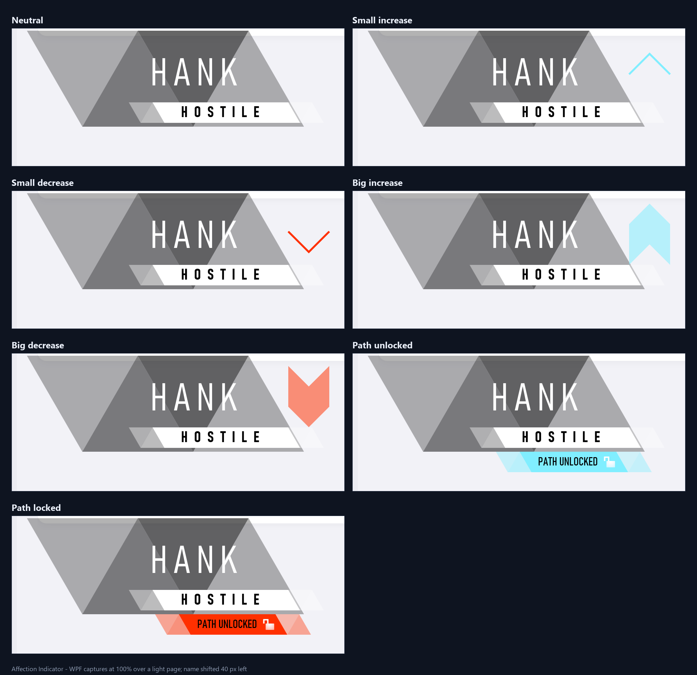

# Affection Indicator

A desktop port of the **Detroit: Become Human** relationship gauge
(`GLOBAL_GAUGE_BENDING`) for Windows. The gauge is drawn as a transparent,
always-on-top WPF overlay, with a tray app, an Apple-style settings window,
auto-start, manual state previews, a localhost TCP control channel, basic
network-availability switching, and bridge pairing for the web/Wear OS
controllers.



> The screenshot above is a composite of the rendered WPF overlay. Development
> captures are kept locally and are not part of the build.

## Features

- **Transparent, click-through overlay** – no window chrome, no taskbar button,
  topmost when enabled.
- **All seven source states** – neutral, small increase/decrease, big
  increase/decrease, path unlocked and path locked.
- **Resource-faithful presentation** – triangle name strip, accordion adjective
  plate, chevrons, masked big arrows, padlock textures, 30 fps frame timing,
  scale/offset coordinates, blue `#80EEFF` and red `#FF3000`.
- **Extracted textures** – `Assets/Lock_part1.png` and `Assets/Lock_part2.png`.
- **Tray controls** – show/hide, preview any state, settings, always-on-top,
  network auto-switch, live network status, exit.
- **Auto-start** – `HKCU\Software\Microsoft\Windows\CurrentVersion\Run`.
- **Manual switching** – preview buttons or the tray state menu.
- **Basic network switching** – when connectivity comes online/offline the
  overlay shows an increase/decrease (optional).
- **Positioning** – six anchors, custom offsets, 0.70–1.60× scale, or drag the
  gauge directly while click-through is off. The character name has its own
  horizontal/vertical offset controls in Appearance. Everything is persisted.
- **Localhost control** – one command per line on `127.0.0.1:8765`.
- **Bridge pairing** – on first launch, hashes the motherboard serial and
  requests a device ID from the bridge website, then keeps a WebSocket open for
  commands from the website or the Wear OS app.

## Requirements

- Windows 10/11 (x64)
- [.NET 9 Desktop Runtime](https://dotnet.microsoft.com/download/dotnet/9.0)
  for running the framework-dependent build
- .NET 9 SDK for building

## Build and run

```powershell
dotnet build AffectionIndicator.sln -c Release
.\AffectionIndicator\bin\Release\net9.0-windows\win-x64\AffectionIndicator.exe
```

To build a self-contained folder instead:

```powershell
dotnet publish AffectionIndicator\AffectionIndicator.csproj -c Release `
  -r win-x64 --self-contained true -p:PublishSingleFile=false
```

`--autostart` starts the tray app without opening the settings window; that is
the argument written to the Run key.

## Using it

The first launch opens Settings.

- **General** – always-on-top, click-through, start with Windows, preview states
  and set the displayed name/adjective. Press **Preview** to apply the text.
- **Appearance** – anchor, horizontal/vertical offsets, scale, reset position.
  The **Name position** card moves the character name independently with
  horizontal/vertical sliders; **Preview name** shows the result and **Reset
  name** restores the default. Turn off **Click-through** on General, then drag
  the gauge directly. The new position is saved as a custom anchor.
- **Network** – live online/offline status, network auto-switch, TCP server
  toggle, port and listening status.
- **Bridge** – pairing status, the device ID (with **Copy**), bridge URL,
  enable toggle, **Reconnect**, **Reset pairing**, and **Open bridge website**.
- **About** – provenance, settings path and quick controls.

Closing the settings window hides it; the app keeps running in the tray.
Double-click the tray icon to bring it back. Use **Exit** in the tray menu to
quit.

Settings are stored at:

```
%APPDATA%\AffectionIndicator\settings.json
```

## Bridge pairing

The desktop pairs with the `BridgeServer` project in the repository root:

```powershell
dotnet run --project BridgeServer --urls http://0.0.0.0:5210
```

On first launch the desktop:

1. reads the motherboard serial (`Win32_BaseBoard.SerialNumber`, falling back to
   the system product UUID and then the machine name),
2. hashes it with SHA-256 (the raw serial is never sent),
3. requests a 10-character device ID from
   `POST {BridgeUrl}/api/devices/register`,
4. saves the ID and private token in `settings.json`, and
5. opens a WebSocket to `/ws/device?id=...&token=...` and waits for commands.

The same ID is used by the bridge website and the Wear OS app. The token stays
on the desktop and authenticates the WebSocket. Registration is idempotent, so
later launches reconnect with the stored pair; if the server data is reset, a
new ID is issued and shown on the Bridge page.

The default URL is `http://localhost:5210`. A remote bridge can be used by
changing **Bridge URL**; the app clears the old pairing and requests a new ID
from that server. The WebSocket scheme is derived (`ws`/`wss`).

Bridge command requests may include optional `name` and `adjective` fields;
the bridge sends `name:...` and `adj:...` before the state. The Wear app uses
this for its saved custom button.

## Localhost control protocol

Enable **TCP control server** on the Network page, then connect to
`127.0.0.1` on the configured port (default `8765`). The server greets with
`AFFECTION INDICATOR READY` and answers every command with `OK <command>`.
Send `quit` to close the connection.

| Command | Effect |
| --- | --- |
| `inc` / `increase` | small increase |
| `dec` / `decrease` | small decrease |
| `inc+` / `increaseplus` / `biginc` | big increase |
| `dec+` / `decreaseplus` / `bigdec` | big decrease |
| `unlock` / `unlocked` | path unlocked |
| `lock` / `locked` | path locked |
| `neutral` / `none` | name/adjective only |
| `show` | show the indicator (increase) |
| `hide` | hide the overlay |
| `state:<n>` | switch by numeric state, `-1`..`5` |
| `name:<text>` | change the displayed name |
| `adj:<text>` | change the displayed adjective |

PowerShell example:

```powershell
$c = New-Object Net.Sockets.TcpClient('127.0.0.1', 8765)
$s = $c.GetStream()
$r = New-Object IO.StreamReader($s)
$w = New-Object IO.StreamWriter($s)
$w.AutoFlush = $true
$r.ReadLine()          # AFFECTION INDICATOR READY
$w.WriteLine('inc+')   # big increase
$r.ReadLine()          # OK inc+
$w.WriteLine('quit')
$c.Close()
```

## Layout and rendering notes

The source viewer is preserved in `../indicator_demo/` (open
`indicator_demo/index.html`). The C# renderer uses the presentation layout:

- view box: `520 × 236` DIP at stage origin `(1446, −66)`
- name base center at `x = 1732`, `y = 26` (40 px left of the source `1772`);
  further adjustable by `NameOffsetX/Y` from the Appearance page
- adjective plate/padlock shifted `−40`
- big arrow lifted `−20`
- 10 px tracking, Bahnschrift Condensed
- black translucent triangle strip, white/blue/red accordion plates
- one-shot animation: frames at 30 fps, fade-out starts at 1.9 s and completes
  at 2.4 s

The gauge uses the extracted `Lock_part1.png` / `Lock_part2.png` textures. The
`Success_Arrow.png` asset in the web reference is unused; the big arrow uses the
same six-point geometry as the reconstructed Scaleform code.

## Project layout

```
AffectionIndicator/
  App.xaml(.cs)              startup, single instance, tray/network/TCP wiring
  MainWindow.xaml(.cs)       transparent topmost overlay, positioning, drag
  Rendering/
    GaugeRenderer.cs         complete WPF port of the gauge drawing
    GaugeView.cs             FrameworkElement render host
    GaugeState.cs            state enum
  Views/
    SettingsWindow.xaml(.cs) Apple-style settings UI
  Services/
    SettingsService.cs       JSON persistence
    StartupService.cs        HKCU Run key
    NetworkMonitor.cs        interface availability monitor
    ControlServer.cs         localhost TCP command channel
    MachineIdentity.cs       baseboard serial / UUID fingerprint hash
    BridgeClientService.cs   registration, WebSocket receive loop, reconnect
    TrayService.cs           NotifyIcon and context menu
  Models/AppSettings.cs      persisted settings model
  Assets/                    extracted padlock textures
```

`AffectionIndicator.sln` is the solution entry point.

## Limitations

- The overlay anchors to the **primary monitor work area**; per-monitor anchor
  selection is not implemented yet.
- Network switching is a basic interface-availability probe, not an internet
  reachability check. A machine with an always-up virtual adapter can report
  online while offline.
- No sound is played. The source dispatches named Scaleform sound events; the
  audio bank was not located.
- The source gauge is a one-shot notification; there is no persistent meter.
- The control server binds to loopback only and has no authentication. Do not
  expose the port.
- The bridge is designed for a trusted LAN. The website/watch authenticate with
  the 10-character device ID, but the bridge has no TLS or user accounts; do
  not expose port 5210 to the internet.
- Bridge pairing requires `BridgeServer` to be running. If it is offline, the
  desktop shows a waiting state and retries in the background.

## Provenance

Geometry, timing, palette and textures are reconstructed from the extracted
`comData.GLOBAL_GAUGE_BENDING` Scaleform bundle and the reference viewer in
`../indicator_demo/`. This is a fan-made desktop experiment; Detroit: Become
Human and its assets belong to Quantic Dream.
