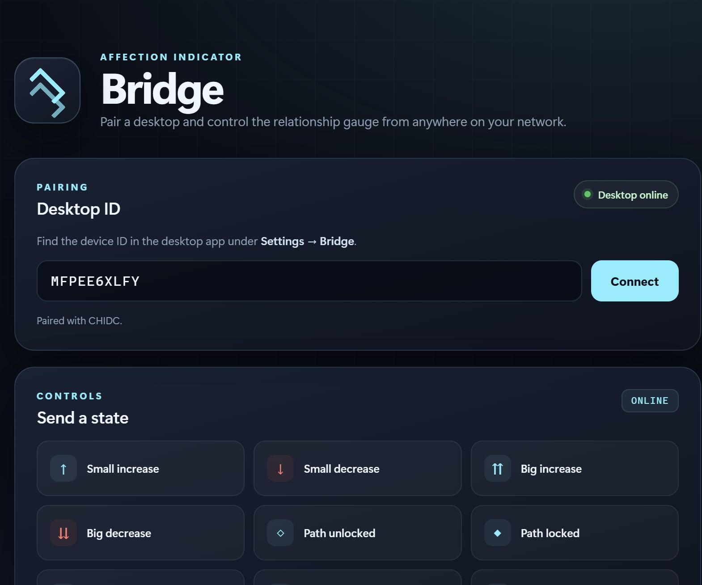
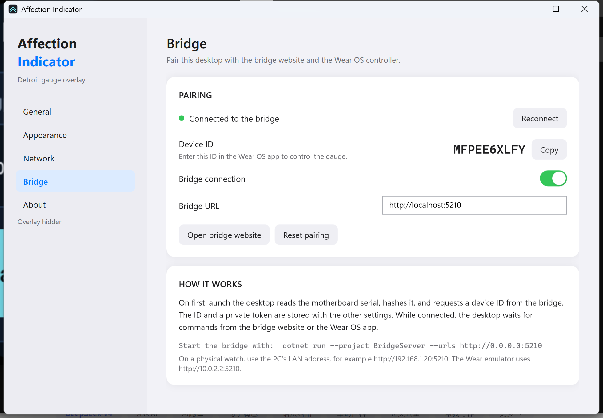
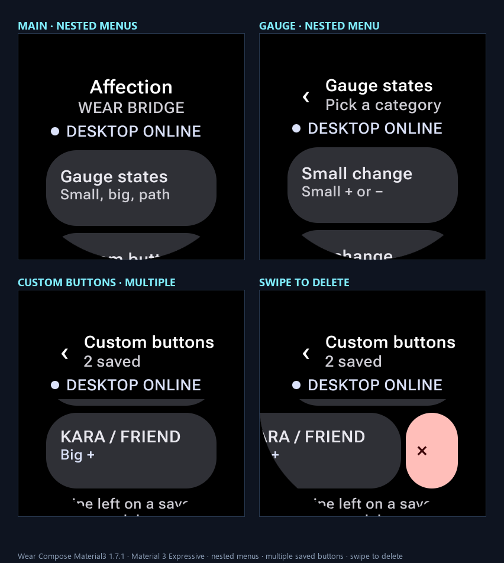
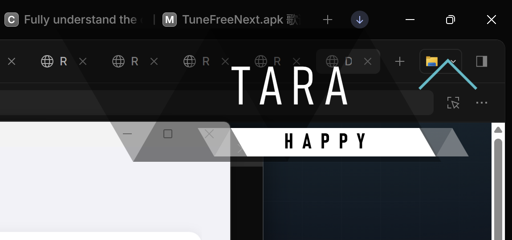

# DetroitIndicator

A complete desktop + bridge + Wear OS port of the **Detroit: Become Human**
relationship gauge (`GLOBAL_GAUGE_BENDING`).

The desktop is a transparent, always-on-top WPF overlay. On first launch it
reads the motherboard serial, hashes it, and pairs with the bridge website to
receive a 10-character device ID. It then keeps a WebSocket open and waits for
commands from the bridge website or the Wear OS app.

| Bridge website | Desktops |
| --- | --- |
|  |  |



## Components

```
AffectionIndicator/   WPF desktop overlay, tray app, settings, bridge client
BridgeServer/         ASP.NET Core bridge website + WebSocket command relay
WearController/       Wear OS controller app (Kotlin, Compose Material 3 Expressive)
indicator_demo/       browser reference implementation of the gauge
docs/                 screenshots
```

## Features

### Desktop

- Transparent, click-through overlay with all seven gauge states.
- Extracted padlock textures, triangle backdrop, accordion plates, chevrons,
  masked big arrows, source palette and 30 fps one-shot timing.
- Tray menu: show/hide, preview states, settings, topmost, network auto-switch,
  live network status, exit.
- Auto-start, manual switching, localhost TCP control.
- Adjustable gauge position and independent name position.
- **Bridge pairing**: first launch fingerprints the motherboard serial and
  requests a device ID; the ID/token are persisted and the desktop reconnects
  automatically on later launches.

### Bridge

- `POST /api/devices/register` is idempotent for a serial hash.
- Desktop WebSocket channel at `/ws/device`.
- Website with an ID field, online status, and gauge control buttons.
- REST command endpoint used by the website and the watch.
- JSON device store, basic LAN security, health endpoint.

### Wear OS

- **Material 3 Expressive** via Wear Compose Material3 `1.7.1` (latest stable).
- **Nested menus**: Main → Gauge → Small / Big / Path / Visibility;
  Custom buttons → editor → state picker; Pairing.
- Online/offline status with dynamic color theming.
- **Multiple saved custom buttons**: save a name + adjective + state, tap to
  send them, and swipe a saved button left to reveal Delete. A full swipe or
  tapping the Delete action removes it.
- Small/big increase and decrease, unlock/lock, neutral, show/hide.

The resulting desktop state after sending a saved custom button:



To create one: **Custom buttons → New button**, enter a name and adjective,
pick a state, and tap **Save button**. Saved buttons persist in the watch
preferences. Tap a button to send its state and text; swipe left to delete it.
The custom name/adjective become the desktop's current name/adjective, so the
overlay shows them and later states continue to use them until changed.

## Requirements

- Windows 10/11 x64
- [.NET 9 Desktop Runtime](https://dotnet.microsoft.com/download/dotnet/9.0)
  (SDK to build)
- Android SDK 37 + JDK 17 to build the Wear app
- Gradle 9.8.2 (the included wrapper downloads it)
- Wear OS 3+ device or emulator to run the Wear app

## Run it

### 1. Start the bridge

```powershell
dotnet run --project BridgeServer --urls http://0.0.0.0:5210
```

Open <http://localhost:5210> for the bridge website.

For a physical watch on Wi-Fi, allow TCP 5210 on the private network and use
the PC's LAN address in the watch app:

```powershell
New-NetFirewallRule -DisplayName "Affection Bridge" -Direction Inbound `
  -Protocol TCP -LocalPort 5210 -Action Allow -Profile Private
```

### 2. Start the desktop

```powershell
dotnet build AffectionIndicator.sln -c Release
.\AffectionIndicator\bin\Release\net9.0-windows\win-x64\AffectionIndicator.exe
```

On first launch the app requests an ID. Open **Settings → Bridge** to see the
ID and connection status. The default bridge URL is
`http://localhost:5210`.

### 3. Start the watch controller

```powershell
cd WearController
$env:ANDROID_HOME = "D:\Android"
.\gradlew.bat assembleDebug
adb install -r app\build\outputs\apk\debug\app-debug.apk
adb shell am start -n com.chidc.affectionwear/.MainActivity
```

- Emulator URL: `http://10.0.2.2:5210`
- Physical watch URL: `http://<PC-LAN-IP>:5210`
- Enter the ID shown in the desktop's **Settings → Bridge**, then **Save & check**.

### 4. Or use the bridge website

Open the website, enter the same device ID, and press **Connect**. The page
shows **Desktop online** and enables the control buttons.

## First-launch pairing flow

```
motherboard serial
      │  SHA-256
      ▼
POST /api/devices/register ──► 10-character ID + private token
      │                              │
      │ stored in settings.json      │ stored in bridge data
      ▼                              ▼
WebSocket /ws/device ◄──── commands from website/watch
```

The serial hash is only used to keep the pairing stable; the raw serial is not
sent. Registration is idempotent, so a server restart or a reinstall returns
the same ID for the same machine.

## Documentation

- Desktop usage, TCP protocol, layout notes and limitations:
  [`AffectionIndicator/README.md`](AffectionIndicator/README.md)
- Bridge API, networking and security:
  [`BridgeServer/README.md`](BridgeServer/README.md)
- Wear app build/install/use:
  [`WearController/README.md`](WearController/README.md)

## Notes and security

This is a fan-made desktop experiment. Detroit: Become Human and its assets
belong to Quantic Dream; this project is not affiliated with or endorsed by
Quantic Dream.

The bridge uses a random device ID for website/watch control and a private
token for the desktop connection. There is no TLS, account system, or
per-command authentication. Use it on a trusted LAN only; do not expose port
5210 to the public internet.

Settings are stored at `%APPDATA%\AffectionIndicator\settings.json`.
